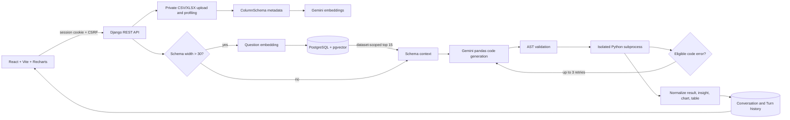

# DataPilot

DataPilot is a session-authenticated Django and React application for exploring uploaded CSV and XLSX files with natural-language questions. Gemini generates pandas code from a bounded schema context; a validator and separate worker process constrain execution. The UI returns a concise factual summary, a bounded result table, and a deterministic chart when the result shape supports one.

## Architecture and request flow



The React app uses Django's existing authentication session; there is no second login system. `frontend/src/api.js` sends session cookies and obtains the CSRF token from the API before state-changing requests.

## Requirements

- Python 3.11 or newer
- Node.js and npm
- PostgreSQL with the pgvector server extension for vector retrieval
- A Gemini API key for code generation and embeddings

SQLite is the default when `DATABASE_URL` is not set. It is suitable for local Django tests, but it does not provide pgvector similarity search.

## Local setup

From the repository root, create and activate a virtual environment, then install the Python dependencies:

```powershell
py -3 -m venv .venv
.\.venv\Scripts\Activate.ps1
python -m pip install -r requirements.txt
```

Install the pgvector server extension for your PostgreSQL installation and create a database and role. The role applying migrations must be allowed to create the `vector` extension (often a database administrator creates it first). See [PostgreSQL and pgvector setup](docs/pgvector-setup.md).

Copy `.env.example` to `.env` and set a private `DJANGO_SECRET_KEY`, a PostgreSQL `DATABASE_URL`, and `GEMINI_API_KEY`. Never commit `.env`. The example uses `gemini-embedding-001` with 768 dimensions; changing dimensions requires a schema migration and re-indexing.

Apply migrations and create a Django account:

```powershell
python manage.py migrate
python manage.py createsuperuser
```

Start Django in one terminal:

```powershell
python manage.py runserver
```

Install and start the frontend in another terminal:

```powershell
cd frontend
npm install
npm run dev
```

Open the frontend at `http://127.0.0.1:5173/`, then sign in through Django at `http://127.0.0.1:8000/accounts/login/`. Set `VITE_API_BASE_URL` only if the API is hosted somewhere other than `http://127.0.0.1:8000/api`.

## Configuration

| Variable | Default | Purpose |
| --- | --- | --- |
| `DJANGO_SECRET_KEY` | development-only fallback | Django signing key; set a secret value outside development |
| `DJANGO_DEBUG` | `0` | Enable Django debug mode only for local development |
| `DJANGO_ALLOWED_HOSTS` | `localhost,127.0.0.1` | Comma-separated allowed hosts |
| `DATABASE_URL` | SQLite file | PostgreSQL URL; use PostgreSQL plus pgvector for RAG retrieval |
| `GEMINI_API_KEY` | unset | Credential used by Google Gen AI SDK; never sent to the browser |
| `GEMINI_MODEL` | `gemini-3.8-flash` | Gemini code-generation model |
| `GEMINI_REQUEST_TIMEOUT_SECONDS` | `20` | Gemini request timeout |
| `GEMINI_EMBEDDING_MODEL` | `gemini-embedding-001` | Gemini schema and question embedding model |
| `GEMINI_EMBEDDING_DIMENSIONS` | `768` | Vector field and returned embedding size; changing it needs a migration and re-index |
| `DATASET_MAX_UPLOAD_BYTES` | 10 MiB | Maximum upload size |
| `DATASET_MAX_ROWS` | `100000` | Maximum rows processed from an upload |
| `DATASET_MAX_COLUMNS` | `200` | Maximum columns accepted |
| `DATASET_MAX_SCHEMA_CHARS` | `20000` | Maximum schema context size |
| `ANALYSIS_MAX_CODE_CHARS` | `12000` | Maximum generated code size |
| `ANALYSIS_TIMEOUT_SECONDS` | `30` | Worker wall-clock timeout |
| `ANALYSIS_MAX_RESULT_ROWS` | `1000` | Executor result row cap; API displays at most 50 |
| `ANALYSIS_MAX_RESULT_COLUMNS` | `100` | Executor result column cap |
| `ANALYSIS_MAX_OUTPUT_BYTES` | `500000` | Worker JSON response cap |
| `ANALYSIS_MAX_RETRIES` | `3` | Maximum code-correction retries after the first attempt; hard-capped at 3 |
| `DATASET_RAG_COLUMN_THRESHOLD` | `30` | Use vector retrieval when schema has more columns |
| `ANALYSIS_RAG_TOP_K` | `15` | Maximum similar column documents retrieved (hard-capped at 50) |
| `ANALYSIS_RAG_MAX_COSINE_DISTANCE` | `0.7` | Maximum distance accepted as a useful schema match |
| `CORS_ALLOWED_ORIGINS` | local Vite origins | Allowed frontend origins |
| `CSRF_TRUSTED_ORIGINS` | local Vite origins | Trusted frontend origins for CSRF |
| `DJANGO_SECURE_COOKIES` | `0` | Set to `1` behind HTTPS |
| `DJANGO_SECURE_SSL_REDIRECT` | `0` | Set to `1` when deployment is HTTPS-only |

## API

All API routes require an authenticated Django session. The React client uses the CSRF endpoint before POST requests.

| Method | Path | Description |
| --- | --- | --- |
| `GET` | `/api/csrf/` | Return CSRF token for the session |
| `POST` | `/api/logout/` | End the current Django session |
| `GET` | `/api/datasets/` | List the current user's datasets |
| `POST` | `/api/datasets/` | Upload and profile a multipart `file` |
| `GET` | `/api/datasets/<uuid>/` | Retrieve dataset details and profile |
| `DELETE` | `/api/datasets/<uuid>/` | Delete an owned dataset and related metadata |
| `POST` | `/api/analysis/` | Analyze `{ "dataset_id": "…", "question": "…", "conversation_id": "optional UUID" }` |
| `GET` | `/api/conversations/<uuid>/` | Retrieve an owned conversation and turns |

Successful analysis returns `status`, `insight`, `chart`, `table`, `code`, `attempts`, `error`, turn `id`, and `conversation_id`. Failed analyses return a client-safe error and the attempt history with HTTP 422. Result tables contain at most 50 rows and indicate truncation.

## Analysis and safety behavior

Uploads accept `.csv` and `.xlsx` only; Excel reads the first worksheet. Files are stored privately under generated UUID names. Profiles include column names, inferred types, missing/distinct counts, selected numeric statistics, and limited samples. Samples for sensitive-looking column names are omitted, and schema text is privacy-filtered before it is sent to Gemini.

For up to 30 columns, the bounded full profile is sent as schema context. Wider schemas use this path: each column's searchable metadata is embedded with Gemini and saved in `ColumnSchema`; the question receives an embedding from the same model; pgvector cosine-distance search filters to the selected dataset; up to 15 useful columns are formatted and passed to Gemini's code-generation prompt. Embedding, retrieval, or empty-match failures log a safe warning and fall back to the full bounded profile. No raw dataset rows are embedded or sent by default. Questions and filtered schema metadata are processed by Google's external Gemini API.

Generated code must use the supplied pandas DataFrame `df`, import only `pandas`, `numpy`, `math`, or `datetime`, and assign `result`. A pure AST validator blocks disallowed imports, dangerous built-ins, dunder access, and common file/network operations. On eligible validation or runtime errors, the orchestrator sends the original question, prior code, and a short sanitized error back for correction. It allows at most three retries after the initial attempt and persists each attempt on the turn. Timeouts, missing credentials, and worker/infrastructure failures do not trigger code repair.

The executor launches a standalone worker with `sys.executable -I`, a temporary working directory, minimal environment, restricted built-ins/imports, time/output/result caps, and sanitized errors. AST rules and subprocess isolation reduce risk; they are **not a complete sandbox**. Code running as the same operating-system user may still reach resources outside these controls. A successful run also does not prove the analysis is analytically correct. Empty results may be valid.

Charts are selected deterministically: datetime-like first column plus numeric second column produces a line chart; text first column plus numeric second column produces a bar chart limited to 20 categories; other results use a table. Insights are short summaries based only on returned values. Insight generation does not call another LLM.

## Checks

```powershell
python manage.py check
python manage.py makemigrations --check --dry-run
python manage.py test datapilot.tests
cd frontend
npm run build
```

Tests mock Gemini and use SQLite, so they verify code paths and API behavior without requiring a live Gemini credential. They do not verify PostgreSQL pgvector retrieval or live Gemini responses; run an integration environment with PostgreSQL and the extension to verify those services.

## Current limitations

- Dataset uploads are synchronous, with configured size/row/column limits; there is no background job queue or streaming progress.
- The worker timeout and allowlists reduce execution risk but do not provide OS-level sandboxing.
- Gemini output and embeddings require an external API key and are subject to its availability, quotas, and data-processing terms.
- Conversations are associated with one dataset, and follow-ups re-read the original private upload.
- Authentication accounts are created through Django administration/management commands; a public registration flow is not included.
- The frontend's local API default targets `127.0.0.1:8000`; deployments must set the frontend API URL and configure Django CORS, CSRF, host, and secure-cookie settings.

Potential future work includes deployment-specific sandboxing, richer integration tests against PostgreSQL/pgvector, and configurable account onboarding.
